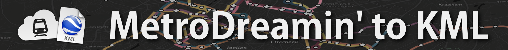

# MetroDreamin' to KML

A Cloudflare Worker that converts [MetroDreamin'](https://metrodreamin.com/)
maps into downloadable KML files.

## Run locally

Requirements: Node.js.

```bash
pnpm install
pnpm run dev
```

Open the local URL printed by Wrangler. Enter a MetroDreamin' map URL and choose
whether to export both lines and stations, only lines, or only stations. The form
submits to `POST /convert` and downloads the returned KML attachment.

## Test and typecheck

```bash
pnpm test
pnpm run typecheck
```
